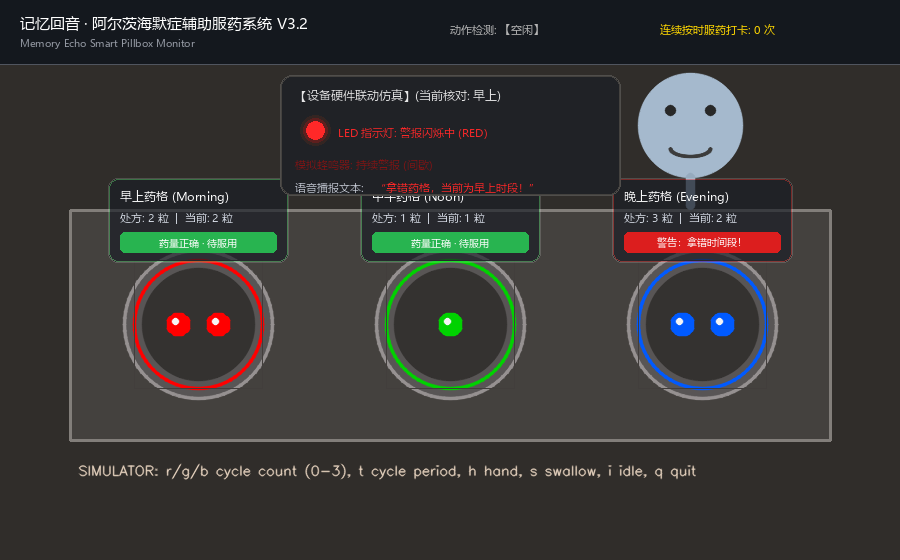

# Smart Pillbox · 智能药盒演示

> **正式演示入口：main 分支。** 家庭圈、用药计划、库存、装药记录及设备状态均在 frontend/。从仓库默认分支下载后按下方「完整演示启动」运行；旧版 OpenCV 独立窗口见后文。

阿尔茨海默症长者辅助服药的智能药盒课程原型。完整网页演示由 React 家属端、FastAPI 模拟设备接口组成；另有独立 OpenCV/Pillow 摄像头原型。家庭圈、计划、装药记录等使用网页入口，摄像头程序不直接提供网页实时视频。

下图为独立视觉原型的旧版截图，并非当前网页界面。



## 功能亮点

- 药格视觉识别：检测早上、中午、晚上三个药格是否有药，并统计药丸数量。
- 处方剂量校验：每个时段可设置预期药量，装药数量不符时提示 `WRONG DOSAGE`。
- 纯视觉取药事件：只根据 `pill_count` 的连续稳定下降生成 `TAKE_MED_EVENT`，不引入吞咽、手势、姿态或人体动作识别。
- 事件防抖：药丸数量下降必须持续至少 2 帧才会确认，降低单帧抖动造成的误报警。
- 防错药机制：非当前时段药格发生已确认取药事件时触发严重警报。
- 多检测后端：支持本地 OpenCV、电脑端本地 YOLO、Roboflow 云端 YOLO。
- 轻量设备预留：业务层统一使用 `SlotVisionResult`，后续可把 FOMO 检测结果转换成同一结构接入。

## 文件结构

```text
.
├── frontend/                    # 正式网页演示（含家庭圈）
├── api_server.py               # FastAPI 模拟设备接口
├── smart_pillbox_opencv.py      # 独立视觉原型
├── assets/
│   └── demo_snapshot_v3_2.png   # 演示截图
├── docs/
│   ├── v4_yolo_opencv_hybrid_upgrade.md  # V4 No-swallow + 检测稳定性说明
│   ├── v4_flowchart_mermaid.md           # V4 流程图
│   ├── demo3.0.md                        # V3 历史需求归档
│   └── implementation_plan.md            # V3 历史实施计划归档
├── requirements.txt
└── .gitignore
```

## 环境安装

建议使用 Python 3.10+。

```bash
python -m venv .venv

# Windows PowerShell
.\.venv\Scripts\Activate.ps1

pip install -r requirements.txt
```

## 快速运行

默认会尝试打开摄像头；如果没有摄像头，会自动切换到模拟器。

```bash
python smart_pillbox_opencv.py
```

强制使用模拟器：

```bash
python smart_pillbox_opencv.py --no-camera
```

保存一张演示截图：

```bash
python smart_pillbox_opencv.py --snapshot outputs/demo.png
```

## 交互按键

- `r`：循环切换早上药格药片数，`0 -> 1 -> 2 -> 3 -> 0`
- `g`：循环切换中午药格药片数
- `b`：循环切换晚上药格药片数
- `Space`：模拟当前时段药格被取空，连续确认后生成 `TAKE_MED_EVENT`
- `t`：切换当前服药时段，`Morning -> Noon -> Evening`
- `q`：退出程序

摄像头画面默认会水平镜像，方便现场演示。如果要关闭镜像：

```bash
python smart_pillbox_opencv.py --no-camera-mirror
```

## 检测后端

### 1. OpenCV 本地检测

默认模式，适合课堂演示和无网络环境：

```bash
python smart_pillbox_opencv.py --detector opencv
```

### 2. 本地 YOLO 检测

电脑端部署时可使用从 Roboflow/Ultralytics 导出的药丸检测权重，例如 `best.pt`：

```bash
python smart_pillbox_opencv.py --detector yolo --yolo-model best.pt
```

注意：通用 `yolo11n.pt` / `yolo26n.pt` 是 COCO 预训练权重，类别是 person、car、sports ball 等，不是药丸模型。程序会过滤非药丸类别，避免误报。请使用药丸数据集训练或导出的专用权重。

### 3. Roboflow 云端 YOLO 检测

可对接 Roboflow Universe 上的 `pill-detection-fnftd/3` 模型：

```bash
set ROBOFLOW_API_KEY=your_api_key
python smart_pillbox_opencv.py --detector roboflow
```

PowerShell 写法：

```powershell
$env:ROBOFLOW_API_KEY="your_api_key"
python smart_pillbox_opencv.py --detector roboflow
```

## YOLO 与 FOMO 的项目定位

当前电脑端原型推荐使用 YOLO：它可以返回每粒药的检测框、置信度和粗类别，适合药片计数与胶囊/片剂识别。

如果未来迁移到轻量设备，可以使用同一类药片数据重新训练 FOMO 模型。FOMO 更适合低功耗设备，重点输出药片区域或中心点，再转换为本项目统一的 `SlotVisionResult`：

```python
present
pill_count
confidence
class_counts
roi
```

这样业务逻辑不依赖具体模型，防错药、剂量校验、取药事件防抖和硬件反馈都可以保持不变。

## 免责声明

本项目是课程作业与原型演示，不可作为真实医疗诊断或用药决策系统。真实使用前需要经过专业数据采集、模型验证、隐私合规与医疗安全评估。

## 完整演示启动（Windows PowerShell）

从 GitHub 下载/克隆 **`main` 分支**，在仓库根目录执行。建议 Node.js 22、Python 3.10+。前端首次安装需要联网；浏览器端中文 OCR 首次加载语言包也需要联网。

终端一（FastAPI 模拟设备接口）：

```powershell
py -3 -m venv .venv
.\.venv\Scripts\python.exe -m pip install -r requirements.txt
.\.venv\Scripts\python.exe -m uvicorn api_server:app --host 127.0.0.1 --port 8000
```

终端二（React 前端；从仓库根目录进入）：

```powershell
cd frontend
npm ci
npm run dev
```

打开 http://127.0.0.1:5173/ ，依次检查「家庭圈」「装药记录」入口。前端构建验证：`npm run build`。`npm ci` 使用已提交的 `package-lock.json`，不要在新机器上用 `npm install` 手动补缺失依赖。

如果使用 pnpm，**不要和 npm 在同一份 `node_modules` 混装**；在干净的前端目录改用 `pnpm install --frozen-lockfile`、`pnpm dev`、`pnpm build`。`pnpm-workspace.yaml` 不再把原生依赖限定到 Linux，pnpm 会按当前 Windows/Linux 系统选择可选包；`pnpm-lock.yaml` 已提交。

Linux/macOS：把 `py -3` 换为 `python3`，虚拟环境的 Python 路径换为 `.venv/bin/python`；前端仍在 `frontend/` 执行相同的 npm 命令。

`frontend/vite.config.ts` 将 `/api` 代理到本机 8000。家庭成员、计划和装药照片保存在**当前浏览器**的 localStorage，换浏览器或清除站点数据后不会同步。设备数据来自 FastAPI 模拟器（非真实摄像头视频）；首页无后端时会显示连接错误，不应将其视为完整演示。详细流程和限制见 [前端说明](frontend/README.md)。

当前系统：Python 模拟设备状态及事件 → FastAPI `/api` → Vite 代理 → 家属端界面。独立 OpenCV/YOLO 摄像头程序的运行方式见前文，不等于网页实时视频。

## Roboflow SDK Integration Note

The Roboflow detector uses the official `inference-sdk` client:

```python
from inference_sdk import InferenceHTTPClient

client = InferenceHTTPClient(
    api_url="https://serverless.roboflow.com",
    api_key=os.getenv("ROBOFLOW_API_KEY"),
)
result = client.infer("YOUR_IMAGE.jpg", model_id="pill-detection-fnftd/3")
```

Do not hard-code the Roboflow API key in source code. Set it before running:

```powershell
$env:ROBOFLOW_API_KEY="your_api_key"
python smart_pillbox_opencv.py --detector roboflow
```
